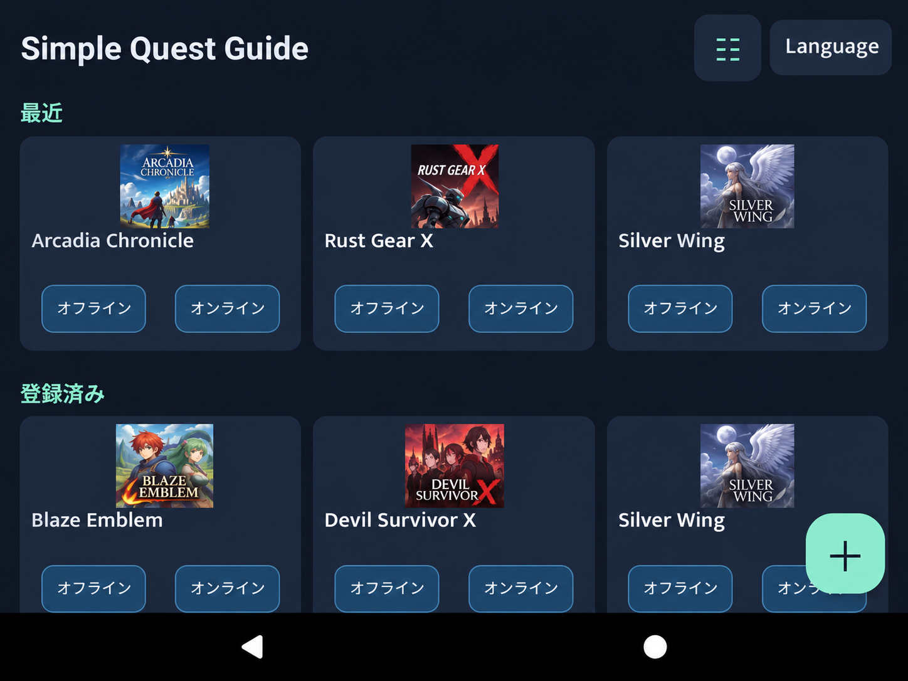
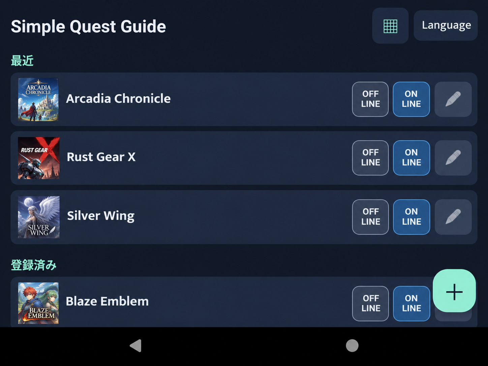
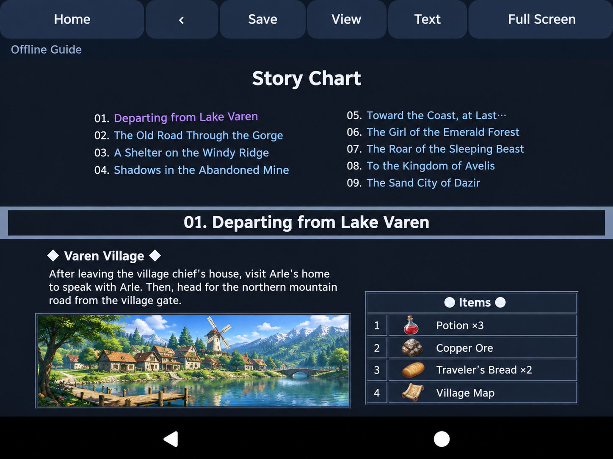

# Simple Quest Guide

**ゲーム攻略サイトを、Androidスマホや携帯ゲーム機で便利に管理・閲覧するためのアプリです。**

[English README](README.md)

Simple Quest Guideは、お気に入りのゲーム攻略サイトをゲームごとに登録して、まとめて管理できるAndroidアプリです。オンライン閲覧だけでなく、対応するページを端末内に保存してオフラインで読むこともできます。

**現在のバージョン：** 0.2.27（ベータ版）

## 主な機能

- **攻略サイトをまとめて管理：** ゲーム名とHTTPSの攻略サイトURLを登録し、後から編集・削除できます。
- **最近使った攻略：** 最近開いたゲームをすぐに選べます。
- **アイコンビュー／リストビュー：** パッケージ画像を並べる表示と、省スペースの一覧表示を切り替えられます。
- **縦画面・横画面に対応：** Androidスマホに加え、Retroid Pocket Duoなどの携帯ゲーム機での利用を想定しています。
- **オンライン／オフライン閲覧：** 普段は攻略サイトをオンラインで開き、対応するページや画像を端末内に保存してオフラインでも閲覧できます。
- **保存状態が分かるボタン：** その端末に攻略の先頭ページが保存されているときだけ、OFFLINEボタンが有効になります。
- **パッケージ画像：** 端末内の画像を選択したり、回転したり、ScreenScraperから検索したりできます（検索にはアカウントとAPI利用設定が必要です）。
- **4言語対応：** 日本語・英語・簡体中国語・韓国語に対応しています。

## ダウンロードとインストール

公開用APKを用意したら、GitHubの **[Releases（リリース）](https://github.com/KINGE1974/simple-quest-guide/releases)** からダウンロードできるようにします。

1. Releasesページを開き、配布版の **Assets** からAPKファイルをダウンロードします。
2. Android端末でAPKを開き、必要に応じて「この提供元からのインストール」を許可します。
3. **Simple Quest Guide** を起動します。

**動作対象：** Android 8.0（API 26）以降。

> GitHubに置かれたソースコードだけでは、アプリを直接インストールできません。ReleasesにAPKがまだ登録されていない場合は、Android Studioでビルドする必要があります。

## 基本的な使い方

1. 右下の **＋** を押してゲームを追加します。
2. **ゲーム名** と、攻略サイトの **HTTPS URL** を入力します。
3. 必要ならパッケージ画像を設定し、登録内容を保存します。
4. 画像またはゲーム名をタップすると、攻略を開く方法を選べます。リスト表示では **ON/LINE・OFF/LINE** ボタンから直接開けます。横画面のアイコン表示でも直接操作できます。
5. オンラインで攻略サイトを開き、画面内の **「保存」** を押すと、対応するページと画像のオフライン保存を開始できます。
6. 先頭ページの保存に成功すると、**その端末の** OFFLINEボタンが有効になります。

登録したゲームを**長押し**すると、編集・削除ができます。削除すると、そのゲームに関連するローカル画像やオフライン保存データも削除されます。

## オフライン閲覧についての注意

> **攻略サイトによっては、オフライン保存（ダウンロード）ができない場合があります。** サイトの構成・スクリプト・アクセス制限などにより保存できないことがあります。また、保存に成功しても、一部のページ・画像・リンク先はオフラインで正しく表示・動作しない場合があります。

- オフライン保存データは**端末ごと**です。Duoで保存したものがスマホへ自動的に同期されることはありません。
- OFFLINEボタンが暗い場合、その端末には利用可能な保存済み先頭ページがありません。
- 攻略サイトの著作権や利用規約を尊重してください。保存した第三者のページや画像を、許可なく再配布しないでください。

## パッケージ画像の検索

画像検索には外部サービス **[ScreenScraper](https://www.screenscraper.fr/)** を使用します。利用する場合は、攻略の追加・編集画面にある **「ScreenScraperの設定」** で、自分のScreenScraper会員アカウントを設定してください。サービスの稼働状況や利用制限により検索できない場合があります。

画像検索を使わず、端末内の画像を自分で選ぶこともできます。

本アプリはScreenScraperやゲームメーカーの公式アプリではありません。

## ソースコードからビルドする場合

1. リポジトリを **Android Studio** で開きます。
2. ScreenScraper画像検索を利用する場合は、`secrets.properties.example` をプロジェクト直下に `secrets.properties` としてコピーし、**自分のScreenScraper開発者認証情報**を設定します。秘密情報はGitHubに登録しないでください。
3. Gradleの同期後、デバッグ版APKをビルドして実行します。

開発者認証情報がなくてもデバッグ版で攻略サイトの登録などの基本機能は試せますが、ScreenScraper画像検索は利用できません。現在の設定では、リリース版のビルドに開発者認証情報が必要です。

**配布担当者への重要な注意：** `secrets.properties` をGitHubに登録しなくても、ビルドしたAPKには開発者認証情報が組み込まれ、**APKから取り出される可能性があります**。公開用APKを配布する前に、ScreenScraperの利用条件と認証情報の扱いを確認してください。署名鍵やパスワードも公開しないでください。

## スクリーンショット

以下は**架空のゲームタイトルとオリジナル画像を使った紹介用のサンプル画像**です。アプリの画面構成や機能を紹介するためのもので、実際の画面とは一部異なる場合があります。

### アイコンビュー

### リストビュー

### オフライン攻略ページ

## ライセンス

Simple Quest Guideの独自ソースコードには **[MIT License](LICENSE)** を適用しています。ただし、このライセンスによって第三者のゲーム画像・攻略サイトの内容・外部サービスの権利まで許諾されるわけではありません。

不具合報告や改善提案は、GitHubのIssuesから歓迎します。
